<p align="center">
  
</p>

<h1 align="center">Lelu</h1>

<p align="center">
  <strong>Authorization engine for AI agents.</strong><br/>
  Every action checked. Every decision logged. Humans in the loop when it matters.
</p>

<p align="center">
  <a href="https://github.com/lelu-ai/lelu/stargazers"></a>
  <a href="https://github.com/lelu-ai/lelu/actions/workflows/ci.yml"></a>
  <a href="https://github.com/lelu-ai/lelu/blob/main/LICENSE"></a>
  <a href="https://pypi.org/project/lelu-agent-auth-sdk/"></a>
  <a href="https://www.npmjs.com/package/lelu-agent-auth"></a>
  <a href="https://lelu-ai.com/sandbox"></a>
  <a href="https://scorecard.dev/viewer/?uri=github.com/Lelu-ai/lelu"></a>
</p>

<p align="center">
  <a href="https://lelu-ai.com/sandbox"><b>Live Sandbox</b></a> ·
  <a href="#try-it-in-one-command"><b>One-Command Start</b></a> ·
  <a href="plugin-claude-code"><b>Claude Code Plugin</b></a> ·
  <a href="examples/"><b>Examples</b></a> ·
  <a href="sdk/mcp"><b>MCP Server</b></a> ·
  <a href="CONTRIBUTING.md"><b>Contributing</b></a> ·
  <a href="GOVERNANCE.md"><b>Governance</b></a> ·
  <a href="docs/SECURITY_ROADMAP.md"><b>Security Roadmap</b></a> ·
  <a href="https://github.com/lelu-ai/lelu/discussions"><b>Discussions</b></a>
</p>

---

<p align="center">
  <picture>
    <source media="(prefers-color-scheme: dark)" srcset="docs/assets/lelu-flow.svg">
    
  </picture>
</p>

<p align="center">
  <picture>
    <source media="(prefers-color-scheme: dark)" srcset="docs/assets/lelu-terminal.svg">
    
  </picture>
</p>

## What is Lelu?

**Lelu is an open-source authorization engine that sits between your AI agent and the real world.** Before the agent takes any action — issuing a refund, sending an email, deleting a record — it asks Lelu first, and Lelu returns one of four decisions:

- ✅ **`allow`** — the action runs
- ⛔ **`deny`** — blocked, with a reason
- 🙋 **`human_review`** — the agent pauses until a human approve
- 🧪 **`compute`** — redirected to a safer alternative or sandbox

It's one HTTP call from any language or framework, every decision is written to an audit log, and the engine runs entirely on your own machine or infrastructure.

## Why Lelu?

**A decision point and approval layer for AI agent actions — with a signed record of every decision.**

Lelu sits next to your policy engine, not in place of it. OPA, Cedar, Cerbos and your identity provider decide who may do what; Lelu adds a human-approval step that is bound to the exact call that was reviewed, and a signed, hash-chained record of every decision. It also offers advisory signals — a phrase-based prompt-injection screen and a confidence gate — that can only make a decision stricter. See [What Lelu does not do](#what-lelu-does-not-do) before you rely on it.

OPA, Casbin, and AWS AVP handle role & permission checks, but stop there. Lelu does that too, and adds:

- Advisory prompt-injection screening (phrase matching; English only, easy to evade — a speed bump, not a defence)
- Confidence gating on a caller-supplied confidence signal (the engine cannot verify it)
- Human-in-the-loop pause → approve → resume (Slack / Teams / PagerDuty)
- Behavioral anomaly & reputation scoring
- A full audit log of every decision

---

## What Lelu does not do

Read this before you depend on Lelu. These limits come from an independent audit of version 0.0.14 and are being worked on; each has a tracking issue.

- **It advises; it does not enforce.** Lelu returns a decision. Something on the agent's side must obey it. The Claude Code plugin and a gateway integration put that step outside the model; an MCP tool the model may choose to call does not.
- **One API key does everything by default.** In the default single-key mode the key an agent authorizes with can also change the policy and resolve reviews. Run with separate credentials: set `LELU_REVIEWER_KEYS` (so only a reviewer key can approve) and keep the admin key away from the agent.
- **Human review is self-service until you set `LELU_REVIEWER_KEYS`.** Without it, any holder of the API key can approve a review, including the agent that triggered it. The engine logs a warning at boot.
- **Actor names are self-asserted** unless the caller presents a workload token (`X-Lelu-Agent-Token`). Policy keyed on actor name protects nothing against a caller that lies about it.
- **YAML policy matches action names, not arguments.** Use Rego for argument-aware rules. A deny list over names can be sidestepped by renaming the action.
- **The injection screen is a speed bump.** It matches a short list of English phrases and misses most paraphrases, other languages and encodings. It also flags ordinary text that contains words like "act as a".
- **Audit events can be dropped under load** unless you set `LELU_AUDIT_BLOCK_ON_FULL=true`.
- **Single process.** The engine stores state in SQLite and process memory. Do not run more than one replica.
- **Set `JWT_SIGNING_KEY` and `VAULT_KEY`** to random values. The defaults are public.

All 17 findings from that audit are closed. What we are fixing next, and in what order, is in the [security roadmap](docs/SECURITY_ROADMAP.md). Found something else? See [SECURITY.md](SECURITY.md).

---

## Try it in one command

No account, no Docker, no config — the real engine runs on your machine:

```bash
npx -y lelu-mcp start
```

Give **Claude Code** guardrails right now:

```bash
claude mcp add lelu -- npx -y lelu-mcp start --transport stdio --preset coding-agent
```

Your agent gets a `lelu_agent_authorize` tool using the **coding-agent** preset: editing files, running tests and local git are allowed; package installs, pushes, deploys and anything touching secrets or env files go to human review; destructive actions are denied; everything else is default-denied. Rules live in `~/.lelu/policy.coding-agent.yaml` (omit `--preset` for the general starter policy in `~/.lelu/policy.yaml`). Cursor / Claude Desktop setup and full docs → [sdk/mcp](sdk/mcp)

### Claude Code plugin — no tool-calling required

The MCP server above gives your agent a tool it can *choose* to call. The Claude Code plugin goes further: it hooks directly into every tool call via Claude Code's own `PreToolUse` hook, so protection doesn't depend on the agent remembering to ask.

```
/plugin marketplace add Lelu-ai/lelu
/plugin install lelu@lelu
```

On first use the plugin downloads its 1.5 MB checker for your platform in the background from this repo's GitHub release and checks it against the release checksums; [what it downloads and why](plugin-claude-code/README.md#what-the-plugin-downloads).

Expansion-aware — `rm -rf ~/`, `rm -rf $HOME`, and reversed/separated/long-form flag variants are all caught, where a regex on the raw command text [catches 7/10 and false-positives on 4/4 benign commands](plugin-claude-code/benchmarks/report.md) — plus retry-storm detection and a session budget for runaway unattended sessions. **Shadow mode by default**, nothing blocks until you ask it to. Full docs → [plugin-claude-code](plugin-claude-code)

The plugin stores its ledger, mode, socket, and daemon log in
`$HOME/.lelu/claude-plugin` by default. Set `LELU_DATA_DIR` to use another
directory; `LELU_HOME` is also accepted as a compatibility alias when
`LELU_DATA_DIR` is not set.

---

## Quickstart (SDK)

```bash
npm install lelu-agent-auth          # TypeScript — or: pip install lelu-agent-auth-sdk
```

```typescript
import { lelu } from "lelu-agent-auth";

// Zero-config: discovers the engine `npx lelu-mcp start` runs on this
// machine (URL + key live in ~/.lelu) — no account, nothing to configure.
// Self-hosted or cloud instead? lelu({ baseUrl, apiKey }).
const auth = lelu();

const decision = await auth.authorize({
  tool: "delete_record",
  context: { confidence: 0.82, actingFor: "user_42" },
});

if (decision.decision === "allow") {
  await deleteRecord(id);
} else if (decision.decision === "human_review") {
  await notifyReviewer(decision.reviewId); // agent pauses, human approves, resumes (reviewId is the queue ID)
} else if (decision.decision === "compute") {
  await saferAlternative(decision.safeTool, decision.safeArgs); // redirected to sandbox
} else {
  throw new Error(decision.reason); // denied
}
```

**Four outcomes. Every decision audited. No other changes to how you build.** Works with OpenAI, Anthropic, LangChain, LangGraph, CrewAI, Strands Agents, Vercel AI SDK, and MCP.

---

## How it works

Every action flows through a layered pipeline — the strictest outcome wins:

- **Prompt-injection filter** — 5 layers: exact → homoglyph → fuzzy → structural → entropy
- **Confidence gate** — caller-supplied token log-probs¹ — low confidence → deny or downgrade
- **Policy evaluator** — YAML roles + OPA/Rego, deny-first, wildcard patterns
- **Risk model** — `criticality × (1 − confidence) × reliability × anomaly_factor`
- **Human-review queue** — uncertain decisions pause for approval (Slack / Teams / PagerDuty)
- **Behavioral analytics** — shadow-agent detection, reputation scoring, baseline drift alerts

¹ The engine checks that the signal is well-formed for the named provider; it cannot check that the numbers came from a real provider response. Treat it as an input to a stricter decision, not as evidence. A provider with no log-probs (e.g. Anthropic Claude) is rejected, and `MissingSignalMode` decides instead.

Also in the box: stable agent identity with RS256 workload JWTs and MCP OAuth 2.1 · an experimental AES-256-GCM OAuth token vault (providers are off until you configure `VAULT_<NAME>_CLIENT_ID`; set `VAULT_KEY`) · an experimental NHI inventory with six heuristic checks over the engine's own data (`/v1/nhi/inventory`).

**Stack:** Go engine · Next.js dashboard · SQLite for the engine (single process; Redis optional for the review queue) · Postgres for the dashboard and control-plane API only

---

## Examples

- [quickstart](examples/quickstart) — the real engine on SQLite: one request per outcome, live prompt-injection catch
- [langchain](examples/langchain) — gate a plain LangChain `StructuredTool` before execution
- [crewai](examples/crewai) — gate CrewAI tool calls; a prompt-injected refund agent gets stopped
- [strands](docs/integrations/strands.md) — register as a Strands intervention handler; denials, safe-tool redirects and human approval all use Strands' own actions
- [bedrock](examples/bedrock) — gate Amazon Bedrock agents on the model's reported confidence (offline demo with a mock response)
- [agentgateway](examples/agentgateway) — Lelu as the decision brain behind agentgateway (ext-authz PEP)

SDKs: [TypeScript](sdk/typescript) · [Python](sdk/python) · [Go](sdk/go) · [MCP server](sdk/mcp) — which engine and SDK versions go together: [docs/COMPATIBILITY.md](docs/COMPATIBILITY.md)

Self-hosting: `npx -y lelu-mcp start` runs the real engine with no build step, or build it yourself from source — `go build ./cmd/engine` or `docker build -f engine/Dockerfile .` — full options in [examples/quickstart](examples/quickstart).

---

## FAQ

<details>
<summary><b>Is it really free?</b></summary>

Yes — the engine, SDKs, MCP server, plugins, and dashboard are MIT licensed. Self-host everything with `npx -y lelu-mcp start`, or build the engine yourself from source. lelu-ai.com also offers a hosted version with paid plans; those pay for hosting, call volume and support, never for security features. The project's commitments on this are in [GOVERNANCE.md](GOVERNANCE.md#open-source-and-the-hosted-service).
</details>

<details>
<summary><b>Can't the agent just lie about its confidence?</b></summary>

Yes, today. By default the engine rejects a bare self-reported number, but it accepts a `confidence_signal` object, and it cannot tell whether that object came from a real provider response. Closing this properly needs the signal to come from something the agent does not control, such as an LLM gateway that sees the provider reply. Until then, confidence can only be used to tighten a decision, and a caller who wants to loosen it can.
</details>

<details>
<summary><b>Does this replace OPA / Casbin / my IAM?</b></summary>

No — it sits on top. Lelu evaluates OPA/Rego and YAML policies as one step of its pipeline, then adds what those tools can't see: prompt-injection detection, confidence gating, behavioral anomaly scoring, and a human-review queue.
</details>

<details>
<summary><b>What happens when a decision is <code>human_review</code>?</b></summary>

The agent pauses, a reviewer gets pinged (Slack / Teams / PagerDuty), and the action resumes or dies with their verdict. Every decision — including the human's — lands in the audit log.
</details>

---

## Contributing

Contributions of every size are welcome — from a typo fix to a new framework integration. Most wanted right now: 🔌 framework integrations (OpenAI Agents SDK, LlamaIndex, AutoGen), 📜 Rego policy templates (SOC 2, HIPAA, GDPR), and 📚 examples.

Pick up a [`good first issue`](https://github.com/lelu-ai/lelu/labels/good%20first%20issue), grab a [`help wanted`](https://github.com/lelu-ai/lelu/labels/help%20wanted) task, or start a thread in [Discussions](https://github.com/lelu-ai/lelu/discussions). Setup and guidelines → [CONTRIBUTING.md](CONTRIBUTING.md)

**If Lelu is useful to you, [a ⭐ star](https://github.com/lelu-ai/lelu/stargazers) helps more people find it — and tells us to keep going.**

## Contributors

Thanks to everyone who has helped build Lelu. Code, docs, examples, design and security reports all count ([emoji key](https://allcontributors.org/docs/en/emoji-key)). Had a pull request merged and you're not here? Open an issue or mention it in your next PR.

<!-- ALL-CONTRIBUTORS-LIST:START - Do not remove or modify this section -->
<!-- prettier-ignore-start -->
<!-- markdownlint-disable -->
<table>
  <tbody>
    <tr>
      <td align="center" valign="top" width="14.29%"><a href="https://github.com/Abenezer0923"><br /><sub><b>Abenezer Getachew</b></sub></a><br /><a href="https://github.com/lelu-ai/lelu/commits?author=Abenezer0923" title="Code">💻</a> <a href="https://github.com/lelu-ai/lelu/commits?author=Abenezer0923" title="Documentation">📖</a> <a href="#infra-Abenezer0923" title="Infrastructure (Hosting, Build-Tools, etc)">🚇</a> <a href="#maintenance-Abenezer0923" title="Maintenance">🚧</a></td>
      <td align="center" valign="top" width="14.29%"><a href="https://github.com/Akuna444"><br /><sub><b>Aklil Solomon</b></sub></a><br /><a href="https://github.com/lelu-ai/lelu/commits?author=Akuna444" title="Code">💻</a></td>
      <td align="center" valign="top" width="14.29%"><a href="https://github.com/Amanuelawol"><br /><sub><b>Amanuelawol</b></sub></a><br /><a href="https://github.com/lelu-ai/lelu/commits?author=Amanuelawol" title="Code">💻</a> <a href="#security-Amanuelawol" title="Security">🛡️</a></td>
      <td align="center" valign="top" width="14.29%"><a href="https://github.com/avp9-nexus"><br /><sub><b>Avp9</b></sub></a><br /><a href="https://github.com/lelu-ai/lelu/commits?author=avp9-nexus" title="Code">💻</a> <a href="https://github.com/lelu-ai/lelu/commits?author=avp9-nexus" title="Documentation">📖</a> <a href="#security-avp9-nexus" title="Security">🛡️</a></td>
      <td align="center" valign="top" width="14.29%"><a href="https://github.com/back-y"><br /><sub><b>Bereket Gezha</b></sub></a><br /><a href="#design-back-y" title="Design">🎨</a> <a href="https://github.com/lelu-ai/lelu/commits?author=back-y" title="Code">💻</a></td>
      <td align="center" valign="top" width="14.29%"><a href="https://github.com/bfs2021"><br /><sub><b>zgy</b></sub></a><br /><a href="https://github.com/lelu-ai/lelu/commits?author=bfs2021" title="Code">💻</a> <a href="#security-bfs2021" title="Security">🛡️</a></td>
      <td align="center" valign="top" width="14.29%"><a href="https://github.com/Emanuel-js"><br /><sub><b>Emanuel</b></sub></a><br /><a href="https://github.com/lelu-ai/lelu/commits?author=Emanuel-js" title="Code">💻</a> <a href="#security-Emanuel-js" title="Security">🛡️</a></td>
    </tr>
    <tr>
      <td align="center" valign="top" width="14.29%"><a href="https://github.com/Eshetugirma"><br /><sub><b>Eshetu Girma</b></sub></a><br /><a href="https://github.com/lelu-ai/lelu/commits?author=Eshetugirma" title="Documentation">📖</a></td>
      <td align="center" valign="top" width="14.29%"><a href="https://github.com/khoap1220-hue"><br /><sub><b>Khoa Phan</b></sub></a><br /><a href="https://github.com/lelu-ai/lelu/commits?author=khoap1220-hue" title="Code">💻</a> <a href="https://github.com/lelu-ai/lelu/commits?author=khoap1220-hue" title="Tests">⚠️</a> <a href="https://github.com/lelu-ai/lelu/commits?author=khoap1220-hue" title="Documentation">📖</a></td>
      <td align="center" valign="top" width="14.29%"><a href="https://github.com/KunjMaheshwari"><br /><sub><b>Kunj Maheshwari</b></sub></a><br /><a href="https://github.com/lelu-ai/lelu/commits?author=KunjMaheshwari" title="Code">💻</a> <a href="https://github.com/lelu-ai/lelu/commits?author=KunjMaheshwari" title="Tests">⚠️</a> <a href="#security-KunjMaheshwari" title="Security">🛡️</a></td>
      <td align="center" valign="top" width="14.29%"><a href="https://github.com/leemeo3"><br /><sub><b>Lee Sang Hoon</b></sub></a><br /><a href="#example-leemeo3" title="Examples">💡</a></td>
      <td align="center" valign="top" width="14.29%"><a href="https://github.com/mafujahmedridoy22-commits"><br /><sub><b>mafujahmedridoy22-commits</b></sub></a><br /><a href="https://github.com/lelu-ai/lelu/commits?author=mafujahmedridoy22-commits" title="Code">💻</a> <a href="#content-mafujahmedridoy22-commits" title="Content">🖋</a></td>
      <td align="center" valign="top" width="14.29%"><a href="https://github.com/mahirhir"><br /><sub><b>Arne Rei</b></sub></a><br /><a href="#example-mahirhir" title="Examples">💡</a></td>
      <td align="center" valign="top" width="14.29%"><a href="https://github.com/nischala755"><br /><sub><b>Nischala G.S</b></sub></a><br /><a href="https://github.com/lelu-ai/lelu/commits?author=nischala755" title="Code">💻</a></td>
    </tr>
    <tr>
      <td align="center" valign="top" width="14.29%"><a href="https://github.com/reflectme-source"><br /><sub><b>reflectme-source</b></sub></a><br /><a href="https://github.com/lelu-ai/lelu/commits?author=reflectme-source" title="Code">💻</a></td>
      <td align="center" valign="top" width="14.29%"><a href="https://github.com/Santoshkumarpuppala"><br /><sub><b>Santosh Kumar Puppala</b></sub></a><br /><a href="https://github.com/lelu-ai/lelu/commits?author=Santoshkumarpuppala" title="Code">💻</a> <a href="#security-Santoshkumarpuppala" title="Security">🛡️</a></td>
      <td align="center" valign="top" width="14.29%"><a href="https://github.com/simonether"><br /><sub><b>Simon Sudarushkin</b></sub></a><br /><a href="https://github.com/lelu-ai/lelu/commits?author=simonether" title="Code">💻</a></td>
      <td align="center" valign="top" width="14.29%"><a href="https://github.com/sronix"><br /><sub><b>Thomas Thomsen</b></sub></a><br /><a href="https://github.com/lelu-ai/lelu/commits?author=sronix" title="Code">💻</a> <a href="#security-sronix" title="Security">🛡️</a></td>
      <td align="center" valign="top" width="14.29%"><a href="https://github.com/tyza66"><br /><sub><b>孙达明</b></sub></a><br /><a href="https://github.com/lelu-ai/lelu/commits?author=tyza66" title="Code">💻</a> <a href="#security-tyza66" title="Security">🛡️</a> <a href="https://github.com/lelu-ai/lelu/commits?author=tyza66" title="Documentation">📖</a></td>
      <td align="center" valign="top" width="14.29%"><a href="https://github.com/urumb"><br /><sub><b>Noel Jacob Antony</b></sub></a><br /><a href="https://github.com/lelu-ai/lelu/commits?author=urumb" title="Code">💻</a> <a href="#content-urumb" title="Content">🖋</a></td>
      <td align="center" valign="top" width="14.29%"><a href="https://github.com/Vedikajawaria"><br /><sub><b>Vedikajawaria</b></sub></a><br /><a href="https://github.com/lelu-ai/lelu/commits?author=Vedikajawaria" title="Documentation">📖</a></td>
    </tr>
    <tr>
      <td align="center" valign="top" width="14.29%"><a href="https://github.com/wdwd200"><br /><sub><b>wdwd200</b></sub></a><br /><a href="https://github.com/lelu-ai/lelu/commits?author=wdwd200" title="Code">💻</a> <a href="https://github.com/lelu-ai/lelu/commits?author=wdwd200" title="Tests">⚠️</a> <a href="#security-wdwd200" title="Security">🛡️</a></td>
    </tr>
  </tbody>
</table>

<!-- markdownlint-restore -->
<!-- prettier-ignore-end -->

<!-- ALL-CONTRIBUTORS-LIST:END -->

---

MIT © [Lelu](https://lelu-ai.com)
